# Attack Simulation & Detection Logic

## 1. Failed Attack Simulation

**Technique:** Password Spraying (MITRE ATT&CK T1110.003)

**Target_machine:**  Windows 11 (10.0.2.10)

**Attack_machine:** kali (10.0.2.15)

**Target accounts:** TestUser1–TestUser8, George.h, sara.ad, Administrator (11 accounts)

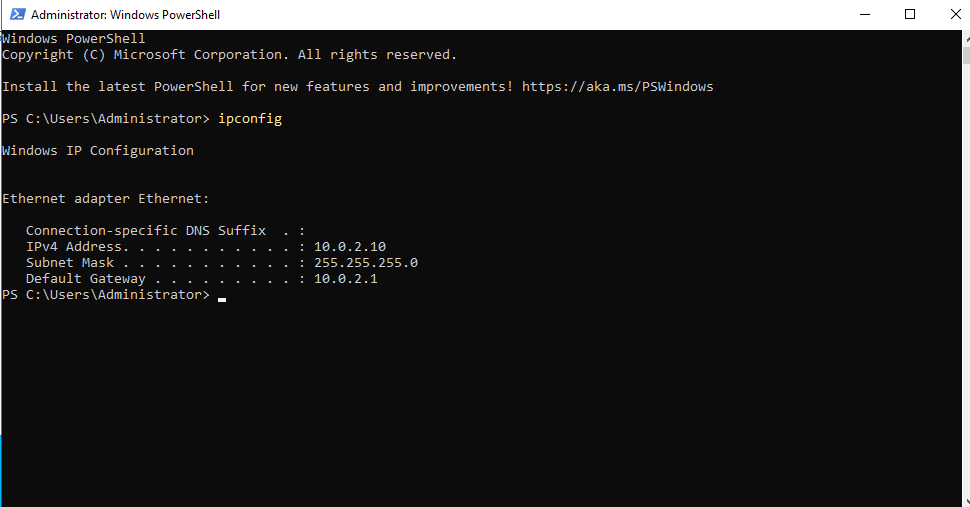

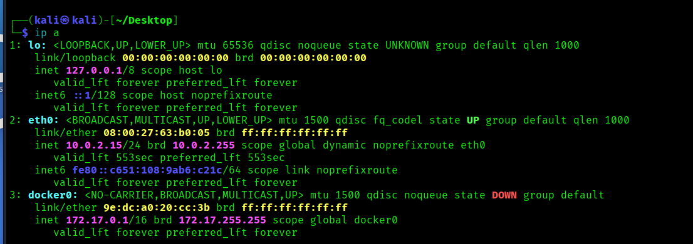

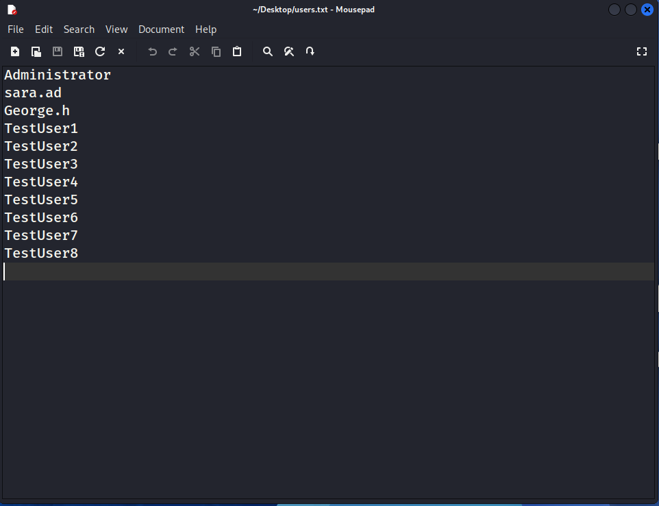


**Command used:**

```nxc smb 10.0.2.10 -u users.txt -p "WrongPassword123"```

The attack attempted a single password against 11 different domain accounts
within the same minute, simulating a low-and-slow spraying attempt designed
to avoid account lockout thresholds while maximizing the chance of hitting
at least one weak password.

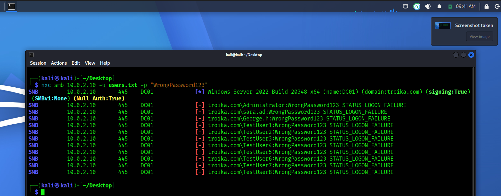


## 2. Detection Logic

### Hypothesis
A single source authenticating as multiple distinct accounts within a
short time window, each with few attempts per account, indicates password
spraying rather than ordinary user error (which typically involves one
account, repeated attempts).

### Splunk Query
```spl
index=wineventlog EventCode=4625
| bin _time span=10m
| stats dc(TargetUserName) as distinct_users, count as attempts, values(TargetUserName) as accounts by _time, src_ip
| where distinct_users>=5
```
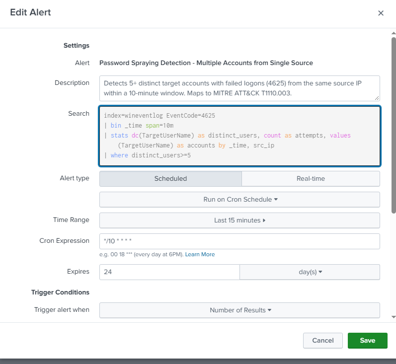

**Threshold rationale:** `distinct_users>=5` within a 10-minute window was
chosen to filter out normal user mistakes (which involve 1 account) while
reliably catching spraying behavior. Validated against lab data showing
10 distinct accounts targeted from a single source within the same minute.

## 3. Validation

The alert was triggered successfully at `09:53`, around 10 minutes after the attack
was executed, confirming the detection logic correctly identifies the simulated spraying pattern.

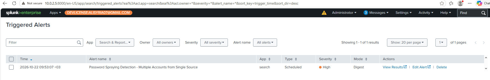

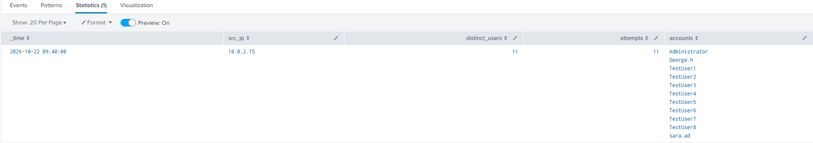


## 4. Successful Attack Simulation

at first I tried this splunk query : 
```
index=wineventlog (EventCode=4625 OR EventCode=4624) src_ip=*
| where NOT match(TargetUserName, "\$$") AND TargetUserName!="SYSTEM"
| bin _time span=15m
| stats count(eval(EventCode=4625)) as fails, count(eval(EventCode=4624)) as successes, dc(TargetUserName) as users_targeted, values(eval(if(EventCode=4624,TargetUserName,null))) as compromised_accounts by _time, src_ip
| where fails>=5 AND successes>=1
```
During validation, I observed that the initial query incorrectly flagged
a non-credentialed connection as a successful logon — an "ANONYMOUS LOGON"
account appeared in the successes field, which would have been misread as
a compromised account. This was not the detection rule correctly firing on
benign activity (a true false positive); it was a logic gap in how the
query identified "success" in the raw event data.

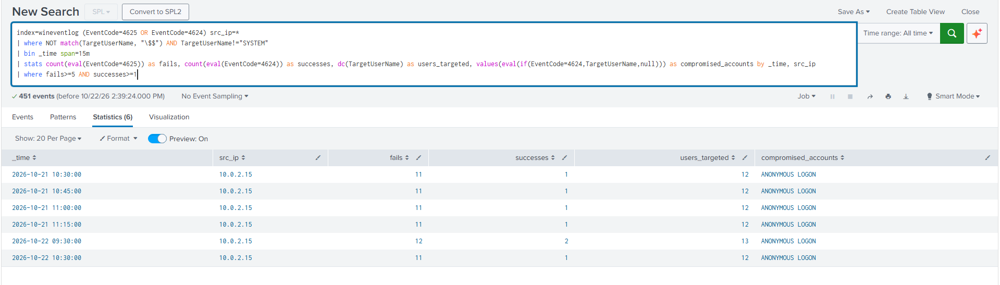

I investigated by isolating the behavior: running the attack tool against
the target with no credentials supplied (`nxc smb 10.0.2.10`) alone
generated the same ANONYMOUS LOGON event (4624, NTLM, no account name).
This confirmed the event originates from an SMB null session the tool
establishes during its connection/reconnaissance phase, independent of
the actual password-guessing attempts — not evidence of credential
compromise.

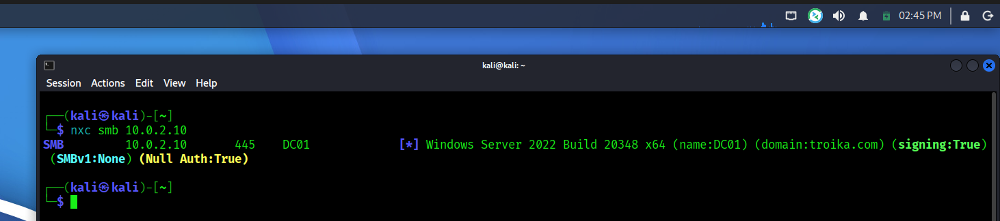

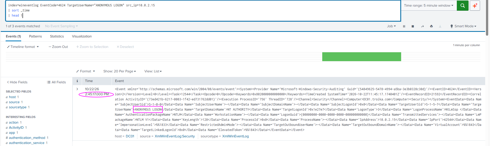

The detection logic was refined to exclude this account from the
"successful logon" condition. Its presence is still worth noting: an
ANONYMOUS LOGON itself can be a reconnaissance indicator and, in a
production environment, may warrant a separate, lower-severity alert.

```
index=wineventlog (EventCode=4625 OR EventCode=4624) src_ip=*
| where NOT match(TargetUserName, "\$$") AND TargetUserName!="SYSTEM" AND TargetUserName!="ANONYMOUS LOGON"
| bin _time span=15m
| stats count(eval(EventCode=4625)) as fails, count(eval(EventCode=4624)) as successes, dc(TargetUserName) as users_targeted, values(eval(if(EventCode=4624,TargetUserName,null))) as compromised_accounts by _time, src_ip
| where fails>=5 AND successes>=1
```
but this rule presented another weakness. 

## 5. Detection Logic Weakness Discovered

Initial testing of the last mentioned alert revealed a design flaw: the rule required 5+ failures
within the *same* 15-minute bin as the success. In a real attack where
the correct password is found early in the account list (e.g., the 3rd
of 10 attempts), only 2 failures precede the success — below the
threshold, causing a missed detection (false negative).

This is a meaningful weakness: a faster or luckier attacker — arguably
the more dangerous case — would evade the rule, while a slower attacker
would be caught. The rule was redesigned to decouple the failure count
from a fixed time bin, instead correlating all failures and the
success per source IP within a wider time correlation window, lowering
the failure threshold to 3 to balance detection coverage against noise.

**The last crafted rule :** 
```
index=wineventlog (EventCode=4625 OR EventCode=4624) 
| where NOT match(TargetUserName, "\$") AND TargetUserName!="SYSTEM" AND TargetUserName!="ANONYMOUS LOGON"
| stats count(eval(EventCode=4625)) as fails, count(eval(EventCode=4624)) as successes, dc(eval(if(EventCode=4625,TargetUserName,null))) as users_targeted, values(eval(if(EventCode=4624,TargetUserName,null))) as compromised_accounts, latest(eval(if(EventCode=4625,_time,null))) as last_fail, latest(eval(if(EventCode=4624,_time,null))) as last_success by src_ip
| where fails>=3 AND successes>=1 AND abs(last_success - last_fail) <= 900
```

which Flags a likely compromised account after a password-spraying attempt.
For each source IP, it looks for a successful logon that happened shortly
after several failed login attempts (excluding system/anonymous noise).
If a recent failure and a recent success from the same source occur
within 15 minutes of each other, the account is likely compromised.
Maps to MITRE ATT&CK T1110.003 (Password Spraying).

**The Second Attack :** 

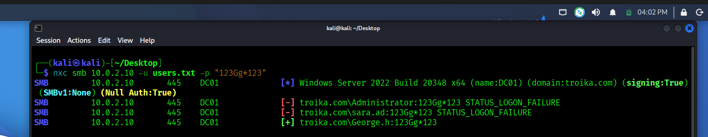


**The resulted Alert :** 

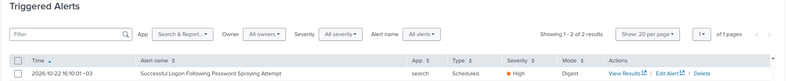

**Alert Details:**

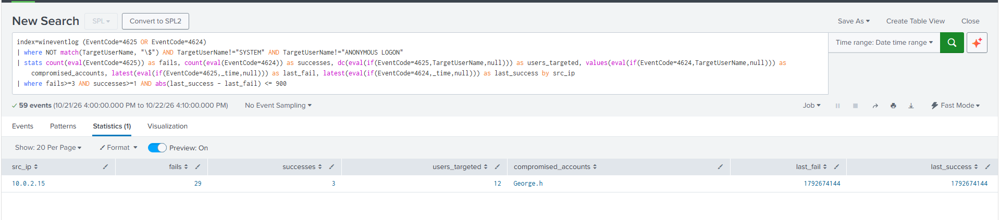


