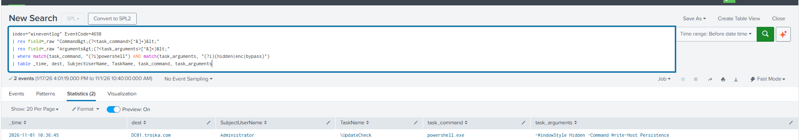

# Attack Simulation & Detection Logic

## 1. Attack Simulation

**Technique:** Scheduled Task Persistence (MITRE ATT&CK T1053.005)

**Target Machine:** Windows Server 2022 DC01 (DC01.troika.com)

### Prerequisite: Enabling Audit Logging

Scheduled task creation (Event 4698) is not logged by default.

### Command Used

```powershell
schtasks /create /tn "UpdateCheck" /tr "powershell.exe -WindowStyle Hidden -Command Write-Host Persistence" /sc onlogon /ru SYSTEM
```


This simulates a common persistence technique: creating a scheduled
task that silently re-executes a PowerShell payload on every logon,
running as SYSTEM for maximum privilege. 

## 3. Detection Rule

### Hypothesis
Legitimate scheduled tasks rarely need to run PowerShell with
hidden-window or obfuscation flags. A scheduled task whose command
invokes PowerShell **combined with** indicators like `-WindowStyle
Hidden`, `-enc`, or `-ExecutionPolicy Bypass` is a reasonable indicator
of persistence set up after a compromise, rather than routine
administrative scheduling.

### Splunk Query
```spl
index="wineventlog" EventCode=4698
| rex field=_raw "Command&gt;(?<task_command>[^&]+)&lt;"
| rex field=_raw "Arguments&gt;(?<task_arguments>[^&]+)&lt;"
| where match(task_command, "(?i)powershell") AND match(task_arguments, "(?i)(hidden|enc|bypass)")
| table _time, dest, SubjectUserName, TaskName, task_command, task_arguments
```

## 5. Validation



