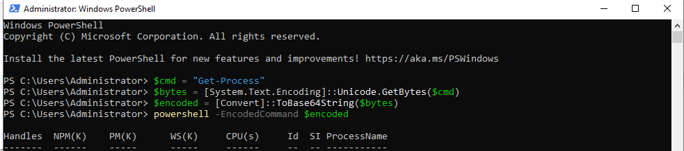
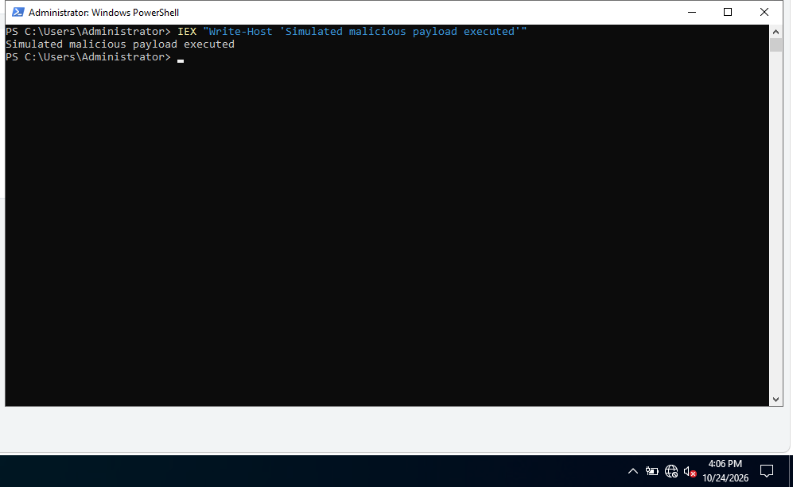
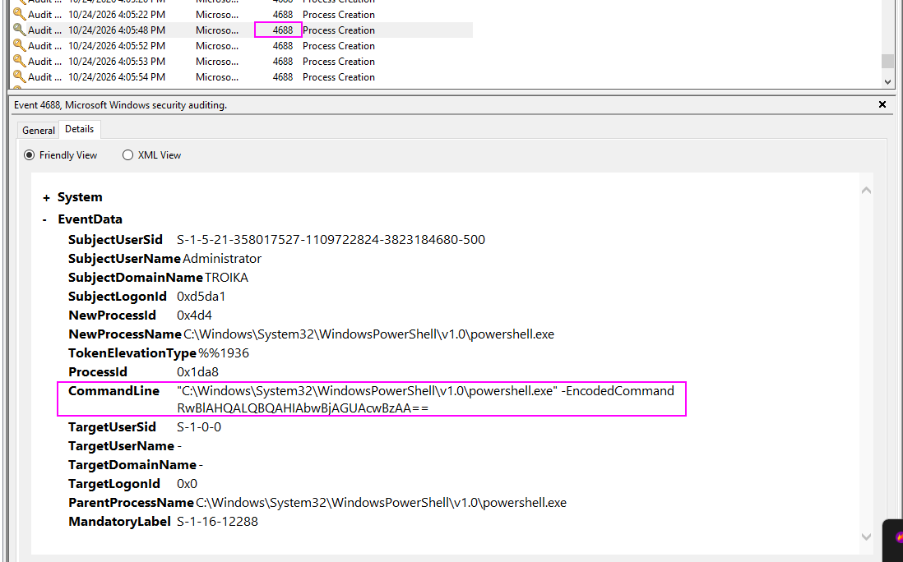
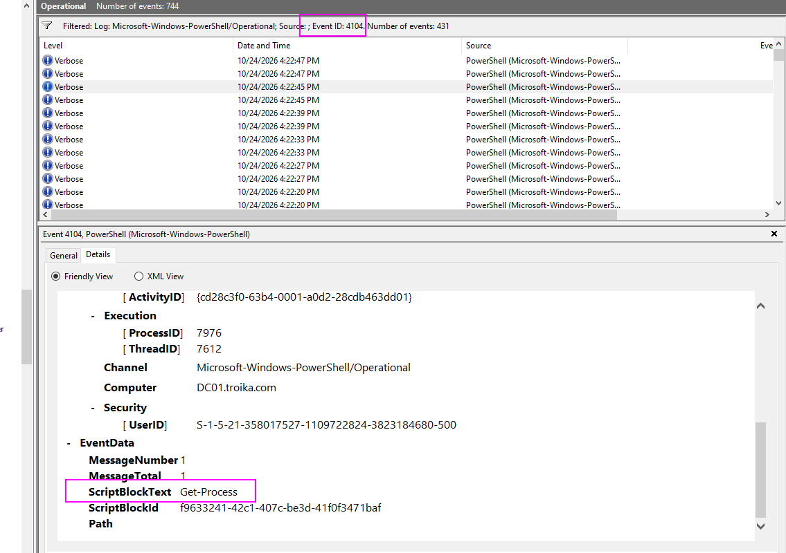
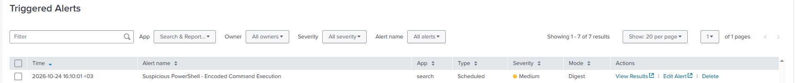
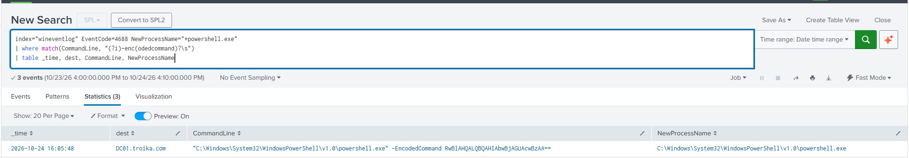
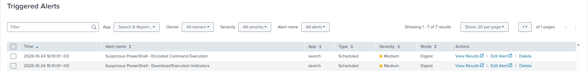
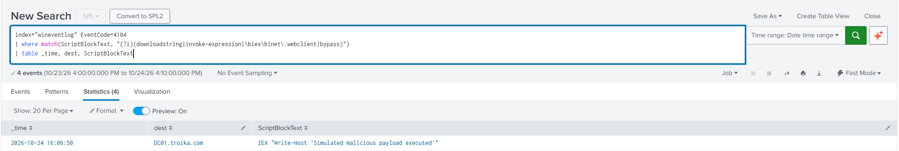

# Attack Simulation & Detection Logic

## 1. Attack Simulations

**Technique:** Suspicious PowerShell Execution (MITRE ATT&CK T1059.001, T1105)

**Target Machine:** Windows Server 2022 DC01 (DC01.troika.com)

### Simulation 1: Encoded Command Execution

**Command used:**
```powershell
$cmd = "Get-Process"
$bytes = [System.Text.Encoding]::Unicode.GetBytes($cmd)
$encoded = [Convert]::ToBase64String($bytes)
powershell -EncodedCommand $encoded
```



This simulates a common evasion technique where attackers encode
PowerShell commands in Base64 to avoid simple string-matching on the
raw command line.


### Simulation 2: Suspicious Content Execution (IEX)

**Command used:**
```powershell
IEX "Write-Host 'Simulated malicious payload executed'"
```


This simulates a simplified download-cradle pattern — using
`Invoke-Expression` to execute dynamically obtained code, a technique
commonly seen in real payload delivery (e.g.,
`IEX (New-Object Net.WebClient).DownloadString(...)`).

## 2. Key Observation: Encoding Visibility Differs by Log Source

The same attack command was logged differently depending on the event
source:

**Event 4688 (Process Creation)** logs the raw command line exactly as
invoked. The Base64 payload remains encoded and unreadable without
manual decoding: 



**Event 4104 (PowerShell Script Block Logging)** captures the command
*after* PowerShell decodes it internally. The real instruction
(`Get-Process`) appears in plain text automatically, with no manual
decoding required:



**Why this matters for detection:** relying on 4688 alone would require
decoding Base64 manually (or building decode logic into the query) to
see what the command actually does. 4104 removes that barrier — the
real payload is visible as-is. This shaped the detection strategy:

- **4688** is used to flag the *technique itself* — the presence of
  `-EncodedCommand`/`-enc`, regardless of what it contains.
- **4104** is used to flag *malicious content* within the decoded
  command (e.g., `IEX`, `DownloadString`) that would otherwise stay
  hidden inside the Base64 string in 4688.

Together, the two rules cover both "an attacker is trying to obscure a
command" and "the obscured command is doing something suspicious" —
two different signals from the same event.

## 3. Detection Rule 1: Encoded Command Usage 

### Hypothesis
Encoding commands with `-EncodedCommand`/`-enc` is a common technique
used by attackers to obscure the real content of a PowerShell command
from the raw command line, making it harder to identify malicious
intent at a glance or through simple string matching. Legitimate
administrative usage rarely requires this flag, so its presence is a
reasonable, low-effort indicator that a command is being deliberately
hidden — regardless of what the encoded content turns out to be.

### Splunk Query
```spl
index="wineventlog" EventCode=4688 NewProcessName="*powershell.exe"
| where match(CommandLine, "(?i)-enc(odedcommand)?\s")
| table _time, dest, CommandLine
```
### Validation
Alert triggered successfully after executing Simulation 1.






## 4. Detection Rule 2: Suspicious Decoded Content

### Hypothesis
Script blocks (post-decoding, via 4104) containing download/execution
indicators — `IEX`, `DownloadString`, `WebClient`, `Bypass` — may
indicate obfuscated payload delivery, independent of whether the
original command was encoded.

### Splunk Query
```spl
index="wineventlog" EventCode=4104
| where match(ScriptBlockText, "(?i)(downloadstring|invoke-expression|\biex\b|net\.webclient|bypass)")
| table _time, dest, ScriptBlockText
```

### Validation
Alert triggered successfully after executing Simulation 2.





**Analysis:** 

this rule is inherently low-fidelity by design. It flags
the *presence* of commands commonly abused for payload execution, not
malicious intent — a decoded script block alone carries no information
about the script's origin or legitimacy.

I considered correlating these events with outbound network activity
(Sysmon Event ID 3), since a real download cradle is typically followed
by an external connection within seconds, while benign admin scripts
usually aren't. I decided against implementing this correlation in the
current version — it adds complexity beyond what this rule needs to
still be useful.

Given this, the rule's severity was kept at Medium rather than High,
and both rules are intended to surface activity for review rather than
trigger automated response.
